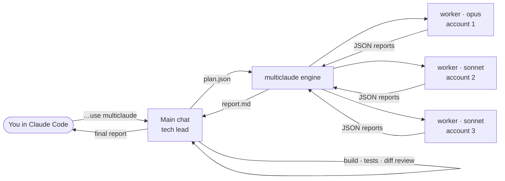
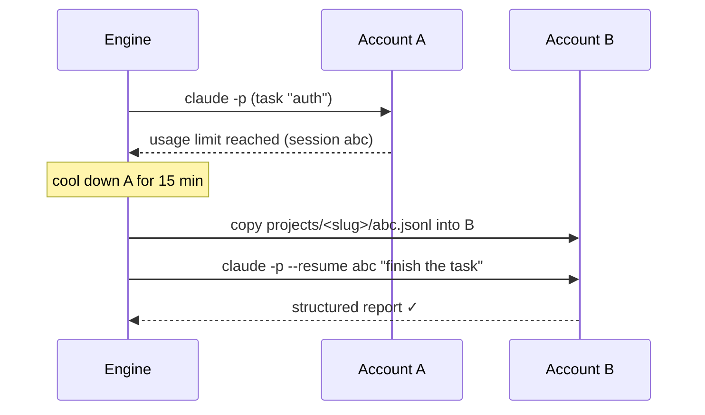

<div align="center">

# multiclaude

**Turn one Claude Code chat into a team of engineers spread across your Claude accounts.**

The chat plans the project, assigns each task to the right model, runs the tasks in parallel, keeps going when an account runs out of usage, then checks the result and reports back.

[](https://github.com/Team1-Turkiye/multiclaude/actions/workflows/ci.yml)
[](LICENSE)


**English** · [Türkçe](README.tr.md)

</div>

---

```text
You:   Build a todo app: Postgres schema, email/password auth, a CRUD API and a clean UI.
       Use multiclaude.

Claude (tech lead, in your chat)
  Plan → 4 tasks
   ▶ schema  [opus]         @ account-1
   ▶ docs    [haiku]        @ account-2
   ✓ schema  done (3m)
   ▶ auth    [opus/high]    @ account-1
   ▶ api     [sonnet]       @ account-3
   ⛔ account-1 hit its limit → auth will continue on another account
   ⇄ auth session moved account-1 → account-2
   ▶ auth    [opus/high]    @ account-2 (resume)
   ✓ api, docs, auth done
  Verify → build ✓  typecheck ✓  tests ✓  security diff reviewed, 1 fix applied
  Final report → in your chat
```

## Why

Big jobs in a single Claude Code session run into three problems:

- **They run one step at a time.** One agent works through every part of the project in sequence.
- **One model is either too expensive or not good enough.** Opus everywhere costs a lot. Sonnet everywhere risks the security and UI work.
- **Usage limits stop the work.** When the account runs out, the session stops and the progress is stuck there.

multiclaude fixes all three. You describe the project in chat. The chat breaks it into a dependency graph of tasks and sends each task to the cheapest model that can do it well. Tasks run in parallel across all your logged-in accounts. When an account hits its limit, the task moves, with its whole conversation, to another account and continues from the same point.

## How it works



1. **Plan.** The main chat (the skill in [`skill/SKILL.md`](skill/SKILL.md)) writes a plan: tasks, dependencies, which files each task owns, a model tier, and a self-contained prompt for each.
2. **Run.** The engine ([`multiclaude.py`](multiclaude.py)) schedules the task graph. Each task runs as a headless `claude -p` worker under one account's `CLAUDE_CONFIG_DIR`. Work is spread across accounts by load.
3. **Fail over.** If a worker hits a usage limit, its account is cooled down. The session transcript is copied to a free account and continued there with `--resume`.
4. **Verify and report.** The main chat runs the build and tests, reads the critical diffs itself, fixes small issues, and writes the final report in your chat.

### Model routing

| Tier | Used for |
|---|---|
| **`opus`** | Security (auth, sessions, permissions, payments, wallets, secrets), polished UI/UX, architecture and API contracts, hard algorithms, concurrency, tricky bugs, reviews. Add `"effort": "high"` for critical security work. |
| **`sonnet`** | Scaffolding, CRUD, wiring to a clear spec, config/CI, tests from a spec, docs, simple refactors, screens that follow existing patterns. |
| **`haiku`** | Trivial mechanical edits. |

### Cross-account resume



Claude Code stores sessions at `$CLAUDE_CONFIG_DIR/projects/<cwd-slug>/<session-id>.jsonl`. Copying that file to another config dir is enough for that account to resume the conversation. Files the worker already wrote are still in the shared working tree. If every account is limited, the engine waits and retries (`--no-wait` exits instead). `multiclaude resume` picks the run up later, even from a different chat.

### Token efficiency

- **Workers start lean.** They load no MCP servers, no skill list, and no user plugins or hooks. On a heavily customised setup that saves tens of thousands of tokens per worker.
- **Workers report in a fixed shape.** They return a short JSON report (`status`, `summary`, `files_changed`, `verification`, `notes`) through `--json-schema`. The tech lead never reads raw transcripts.
- **Only real work gets a worker.** The skill tells the lead not to start a worker for tiny jobs, since each one costs about 20k tokens to start. It also keeps plans to 3–8 tasks.

## Quick start

**Requirements:**
- The [Claude Code](https://docs.claude.com/en/docs/claude-code) CLI.
- Python 3.10+.
- One or more logged-in accounts, each in its own config dir.

```bash
# 1. Log in to each account in its own config dir
claude                                    # account 1 → ~/.claude
CLAUDE_CONFIG_DIR=~/.claude_2 claude      # account 2 → run /login
CLAUDE_CONFIG_DIR=~/.claude_3 claude      # account 3 → run /login

# 2. Install
git clone https://github.com/Team1-Turkiye/multiclaude.git
cd multiclaude && ./install.sh

# 3. Check
multiclaude accounts
```

`install.sh` links the CLI into `~/.local/bin` (change with `BIN_DIR=...`) and the skill into every config dir it finds. Accounts are found automatically as `~/.claude` and `~/.claude_*`. To choose them yourself, set `MULTICLAUDE_ACCOUNTS=~/.claude,~/work-claude`.

## Usage

### In chat (recommended)

Open Claude Code in your project and describe the work:

> Build an admin dashboard for our orders API: role-based auth, an orders table with filters, CSV export, and audit logging. Use multiclaude.

The chat shows a short plan table, runs the engine in the background, verifies the result, and writes the final report. If something gets interrupted, say **"multiclaude resume"**, from any account.

### CLI

```bash
multiclaude run plan.json        # run a plan (see examples/plan.json)
multiclaude status [run_dir]     # report for the latest (or given) run
multiclaude resume [run_dir]     # continue an unfinished run
multiclaude accounts             # list discovered accounts
```

| Option / env | Default | Meaning |
|---|---|---|
| `--parallel N` / `MULTICLAUDE_PARALLEL` | `4` | Max workers at once |
| `--timeout SECONDS` | `3600` | Per task attempt |
| `--no-wait` | off | Exit instead of waiting when every account is limited |
| `MULTICLAUDE_ACCOUNTS` | `~/.claude,~/.claude_*` | Config dirs to use |
| `MULTICLAUDE_COOLDOWN` | `900` | Seconds before a limited account is retried |
| `MULTICLAUDE_CLAUDE_BIN` | `claude` | CLI to call (the tests use a fake) |

### Plan format

```json
{
  "name": "todo-app",
  "context": "Next.js 15 + TypeScript + Drizzle/Postgres. src/ layout. API returns {data|error}.",
  "tasks": [
    {"id": "schema", "title": "DB schema + shared types", "tier": "opus",
     "depends_on": [], "files": ["src/db/**", "src/types/**"],
     "prompt": "… Done when `npx tsc --noEmit` passes."},
    {"id": "api", "title": "Todo CRUD API", "tier": "sonnet",
     "depends_on": ["schema"], "files": ["src/app/api/todos/**"],
     "prompt": "…"}
  ]
}
```

| Field | Required | Description |
|---|---|---|
| `id` | ✓ | Unique task id |
| `prompt` | ✓ | Self-contained instructions with acceptance criteria. Workers don't see your chat. |
| `tier` | | `opus` · `sonnet` (default) · `haiku` |
| `effort` | | `low` · `medium` · `high` · `xhigh` · `max` |
| `depends_on` | | Task ids that must finish first. Their summaries are passed to this worker. |
| `files` | | Paths/globs this task owns. Tasks that run at the same time must not overlap. |
| `use_skills` | | `true` re-enables Claude Code skills for this worker (off by default) |
| `title` | | Shown in reports |

Each run writes to `.multiclaude/<timestamp>-<name>/`: `plan.json`, `state.json` and `report.md`. The folder ignores itself in git.

## Safety

- **Workers run with `--permission-mode bypassPermissions`** in your working tree, so they can edit files and run commands without asking. Their instructions forbid rewriting git history and editing outside their scope. Still, start from a clean commit and only use multiclaude in repos you trust.
- **Nothing is committed automatically.**
- **Costs in reports are estimates.** They are API-equivalent figures from the CLI, not a bill.
- **Use only accounts you're entitled to use**, for example your personal and work seats. Make sure your usage follows [Anthropic's terms](https://www.anthropic.com/legal). This is an independent community project, not affiliated with or endorsed by Anthropic.

## FAQ

<details>
<summary><b>Do I need several accounts?</b></summary>

No. With a single account you still get planning, parallel workers, model routing, verification and resumable runs. Extra accounts add capacity and failover.
</details>

<details>
<summary><b>Why not Claude Code's built-in subagents?</b></summary>

Subagents run inside one session on one account, so they share its usage limit. multiclaude workers are separate headless sessions that can run on different accounts and move between them.
</details>

<details>
<summary><b>What if two workers edit the same file?</b></summary>

The plan gives each task its own `files` scope, and tasks that run at the same time must not overlap. Shared files (types, schema, `package.json`) go into an early foundation task that the others depend on. Workers are told to stay inside their scope and to mention any exception in their report.
</details>

<details>
<summary><b>Does it work outside git repos?</b></summary>

Yes. Git is only used to show a diff summary in the report.
</details>

## Contributing

Contributions are very welcome. Bug reports, plan recipes, docs, translations and engine features all help. The test suite uses a fake `claude` CLI, so **you don't need any accounts to develop**:

```bash
python3 -m unittest discover -s tests -v
```

See [CONTRIBUTING.md](CONTRIBUTING.md) for the dev setup, design principles and ideas to work on.

## Credits

Created by [**@xBrokkr**](https://github.com/xBrokkr) and maintained under [**Team1 Türkiye**](https://github.com/Team1-Turkiye).

## License

[MIT](LICENSE)
