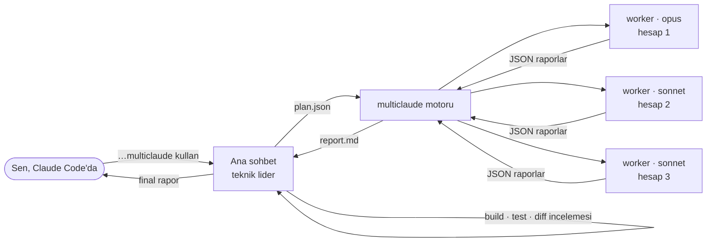

<div align="center">

# multiclaude

**Tek bir Claude Code sohbetini, Claude hesaplarına yayılmış bir mühendis ekibine dönüştür.**

Sohbet projeyi planlar, her görevi doğru modele verir, görevleri paralel çalıştırır, bir hesabın limiti dolunca işi durdurmadan devam ettirir, sonunda kontrol edip rapor verir.

[](https://github.com/Team1-Turkiye/multiclaude/actions/workflows/ci.yml)
[](LICENSE)


[English](README.md) · **Türkçe**

</div>

---

```text
Sen:   Bir todo uygulaması yap: Postgres şeması, e-posta/şifre ile giriş, CRUD API ve temiz bir arayüz.
       multiclaude kullan.

Claude (sohbette teknik lider)
  Plan → 4 görev
   ▶ schema  [opus]         @ hesap-1
   ▶ docs    [haiku]        @ hesap-2
   ✓ schema  bitti (3dk)
   ▶ auth    [opus/high]    @ hesap-1
   ▶ api     [sonnet]       @ hesap-3
   ⛔ hesap-1 limiti doldu → auth başka hesapta devam edecek
   ⇄ auth oturumu hesap-1 → hesap-2 taşındı
   ▶ auth    [opus/high]    @ hesap-2 (devam)
   ✓ api, docs, auth bitti
  Kontrol → build ✓  typecheck ✓  testler ✓  güvenlik diff'i incelendi, 1 düzeltme yapıldı
  Final rapor → sohbette
```

## Neden?

Büyük bir işi tek bir Claude Code oturumunda yaptırmanın üç sorunu var:

- **İş sırayla ilerliyor.** Tek ajan projenin bütün parçalarını tek tek yapıyor.
- **Tek model ya pahalı ya yetersiz.** Her yerde Opus çok pahalı. Her yerde Sonnet ise güvenlik ve arayüz işlerinde risk.
- **Limit dolunca iş duruyor.** Hesabın limiti bitince oturum kesiliyor ve ilerleme orada kalıyor.

multiclaude üçünü de çözüyor. Projeyi sohbette anlatıyorsun. Sohbet işi bağımlılık grafiği olan görevlere bölüyor ve her görevi onu iyi yapabilecek en ucuz modele veriyor. Görevler giriş yapılmış tüm hesaplarında paralel çalışıyor. Bir hesap limite takılırsa görev, bütün konuşma geçmişiyle birlikte başka bir hesaba geçip **kaldığı yerden** devam ediyor.

## Nasıl çalışır?



1. **Plan.** Ana sohbet ([`skill/SKILL.md`](skill/SKILL.md)) bir plan yazıyor. Her görev için bağımlılıklar, görevin sahip olduğu dosyalar, model seviyesi ve tek başına yeterli bir talimat belirleniyor.
2. **Çalıştırma.** Motor ([`multiclaude.py`](multiclaude.py)) görev grafiğini sıraya koyuyor. Her görev, bir hesabın `CLAUDE_CONFIG_DIR`'i altında arka planda çalışan bir `claude -p` olarak koşuyor. İş, hesapların doluluğuna göre dağıtılıyor.
3. **Hesap değiştirme.** Limit hatasında o hesap bir süre dinlenmeye alınıyor. Oturum dosyası boştaki bir hesaba kopyalanıyor ve görev orada `--resume` ile devam ediyor.
4. **Kontrol ve rapor.** Ana sohbet build ve testleri çalıştırıyor, kritik diff'leri kendisi okuyor, küçük sorunları düzeltiyor ve final raporu sohbete yazıyor.

### Model seçimi

| Seviye | Ne için |
|---|---|
| **`opus`** | Güvenlik (giriş, oturum, yetki, ödeme, cüzdan, gizli anahtarlar), kaliteli arayüz/UX, mimari ve API sözleşmesi, zor algoritmalar, eşzamanlılık, çetrefilli hatalar, kod incelemesi. Kritik güvenlik işinde `"effort": "high"` ekle. |
| **`sonnet`** | İskelet kurulumu, CRUD, net bir şartnameye göre bağlantı işleri, config/CI, şartnameden test yazma, dokümantasyon, basit refactor, mevcut kalıbı izleyen ekranlar. |
| **`haiku`** | Önemsiz, mekanik düzenlemeler. |

### Hesaplar arası devam

Claude Code oturumları `$CLAUDE_CONFIG_DIR/projects/<klasör-adı>/<oturum-id>.jsonl` dosyasında tutuyor. Bu dosyayı başka bir hesabın klasörüne kopyalamak, o hesabın konuşmayı devam ettirmesi için yeterli. Worker'ın yazdığı dosyalar zaten ortak çalışma klasöründe duruyor. Tüm hesaplar limitteyse motor bekleyip tekrar deniyor (`--no-wait` ile beklemek yerine çıkıyor). `multiclaude resume` işi sonradan, başka bir sohbetten bile devam ettirebiliyor.

### Token tasarrufu

- **Worker'lar hafif başlıyor.** MCP sunucusu, skill listesi, kullanıcı plugin'leri ve hook'ları yüklemiyorlar. Çok özelleştirilmiş kurulumlarda bu, worker başına on binlerce token tasarruf ediyor.
- **Worker'lar sabit biçimde rapor veriyor.** `--json-schema` ile kısa bir JSON rapor döndürüyorlar (`status`, `summary`, `files_changed`, `verification`, `notes`). Lider hiçbir zaman ham konuşma kaydı okumuyor.
- **Sadece gerçek işe worker açılıyor.** Skill, lidere küçük işler için worker açmamasını söylüyor, çünkü her worker'ın açılışı yaklaşık 20k token tutuyor. Planları da 3–8 görevde tutuyor.

## Hızlı başlangıç

**Gereksinimler:**
- [Claude Code](https://docs.claude.com/en/docs/claude-code) CLI.
- Python 3.10+.
- Her biri kendi config klasöründe giriş yapılmış bir veya daha fazla hesap.

```bash
# 1. Her hesaba kendi klasöründe giriş yap
claude                                    # hesap 1 → ~/.claude
CLAUDE_CONFIG_DIR=~/.claude_2 claude      # hesap 2 → /login
CLAUDE_CONFIG_DIR=~/.claude_3 claude      # hesap 3 → /login

# 2. Kur
git clone https://github.com/Team1-Turkiye/multiclaude.git
cd multiclaude && ./install.sh

# 3. Kontrol et
multiclaude accounts
```

`install.sh` CLI'yi `~/.local/bin` klasörüne (`BIN_DIR=...` ile değiştirilebilir), skill'i de bulduğu her config klasörüne bağlıyor. Hesaplar `~/.claude` ve `~/.claude_*` olarak otomatik bulunuyor. Kendin seçmek istersen `MULTICLAUDE_ACCOUNTS=~/.claude,~/is-claude` kullan.

## Kullanım

### Sohbetten (önerilen)

Projende Claude Code'u aç ve işi anlat:

> Sipariş API'mız için bir admin paneli yap: rol tabanlı giriş, filtreli sipariş tablosu, CSV dışa aktarma ve denetim kaydı. multiclaude kullan.

Sohbet kısa bir plan tablosu gösteriyor, motoru arka planda çalıştırıyor, sonucu kontrol ediyor ve final raporu yazıyor. Bir şey yarıda kalırsa herhangi bir hesaptan **"multiclaude devam"** demen yeterli.

### CLI

```bash
multiclaude run plan.json        # bir planı çalıştır (bkz. examples/plan.json)
multiclaude status [run_dir]     # son (veya verilen) çalışmanın raporu
multiclaude resume [run_dir]     # yarım kalan çalışmayı devam ettir
multiclaude accounts             # bulunan hesaplar
```

Seçenekler ve plan formatının tamamı için [İngilizce README](README.md#cli) dosyasına bak.

## Güvenlik

- **Worker'lar çalışma klasöründe `--permission-mode bypassPermissions` ile çalışıyor**, yani dosya düzenleyip komut çalıştırırken izin istemiyorlar. Talimatları gereği git geçmişine dokunamıyor ve kendi alanları dışındaki dosyaları düzenleyemiyorlar. Yine de temiz bir commit'ten başla ve sadece güvendiğin repolarda kullan.
- **Otomatik commit atılmıyor.**
- **Raporlardaki maliyetler tahmin.** CLI'nin verdiği API-eşdeğeri rakamlar, gerçek fatura değil.
- **Sadece kullanma hakkın olan hesapları kullan**, örneğin kişisel ve iş hesapların. Kullanımının [Anthropic şartlarına](https://www.anthropic.com/legal) uyduğundan emin ol. Bu, bağımsız bir topluluk projesi; Anthropic ile bağlantısı yok ve Anthropic tarafından desteklenmiyor.

## Katkı

Katkılarını bekliyoruz! Hata bildirimi, plan tarifleri, dokümantasyon, çeviri ve motor özellikleri işimize yarar. Test paketi sahte bir `claude` CLI kullanıyor, yani **geliştirmek için hiçbir hesaba ihtiyacın yok**:

```bash
python3 -m unittest discover -s tests -v
```

Detaylar için [CONTRIBUTING.md](CONTRIBUTING.md) dosyasına bak.

## Emeği geçenler

[**@xBrokkr**](https://github.com/xBrokkr) tarafından geliştirildi, [**Team1 Türkiye**](https://github.com/Team1-Turkiye) çatısı altında sürdürülüyor.

## Lisans

[MIT](LICENSE)
